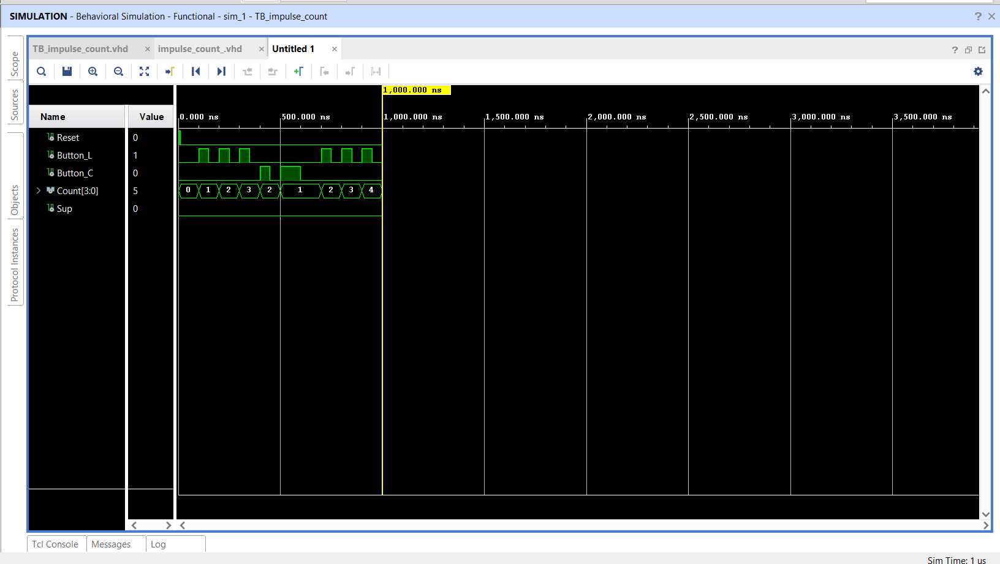
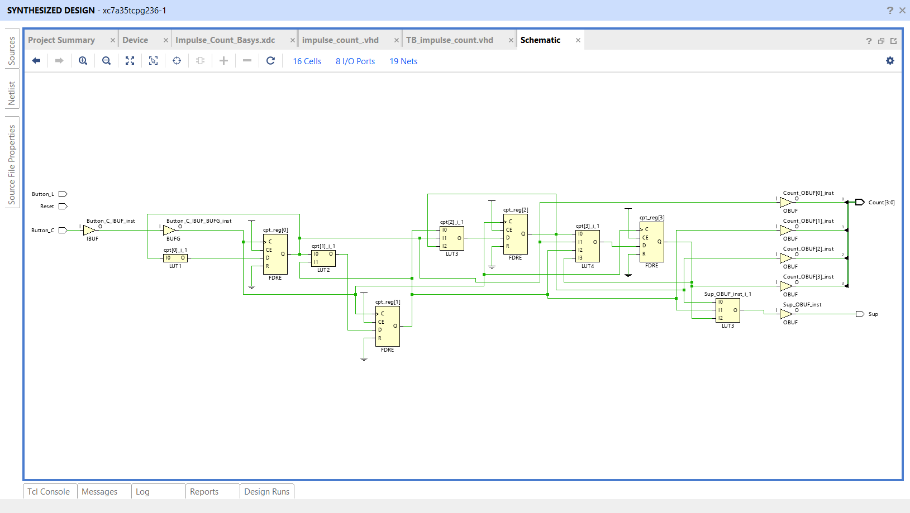
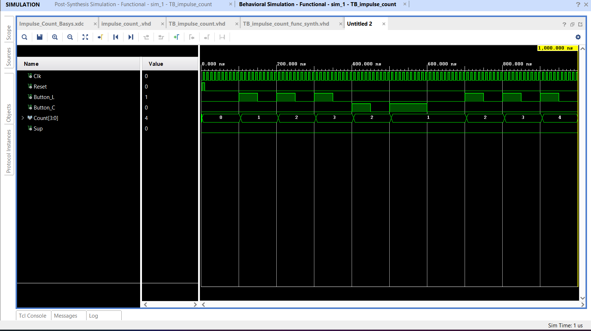
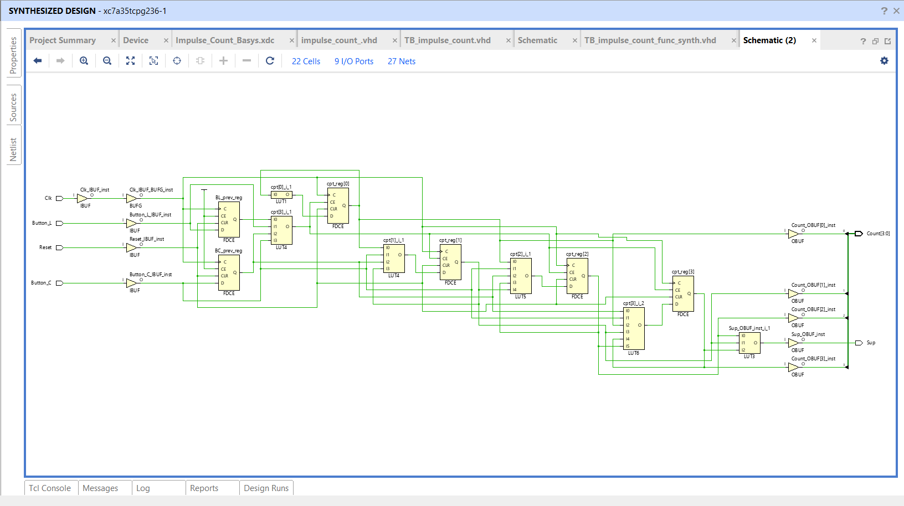
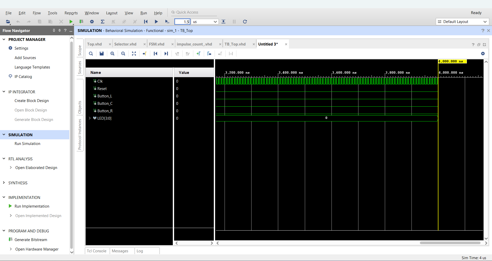

# TP1: VHDL synthesis on Basys 3

Artix-7 XC7A35T, Master 1 SESI, Sorbonne Université (UE MU4IN108). Back to the [overview](../README.md).

- **Tools:** VHDL, Vivado 2020.2 (behavioral and post-synthesis simulation, RTL schematic, synthesis warnings)
- **Design:** `Top` = `Impulse_Count` (4-bit up/down counter) + `Selector` (mode/threshold decoder) + `FSM` (drives 4 LEDs), 100 MHz clock
- **Results:** three synthesis problems found from Vivado warnings and schematics, then fixed

## 1. Dead logic (`Test_CPT_corrige.vhd`)

`Cpt` declared `range 0 to 20000000` but compared to `70000000`: the condition is always false and Vivado removes everything that depends on it.

| Before | After |
| --- | --- |
| `integer range 0 to 20000000` | `integer range 0 to 70000000` |

## 2. Buttons used as clocks (`Impulse_Count_corrige.vhd`)

Two `rising_edge` on `Button_L` and `Button_C` in one process: bouncing, metastability, and Vivado routes a button to a global clock buffer. Rewritten as a synchronous process on `Clk` with rising-edge detection (`Button_x_prev` registers).

| | Before | After |
| --- | --- | --- |
| Behavior | `Count` jumps erratically (0→1→2→3→2→1) | One press = exactly ±1 |
| RTL | 16 cells, button on BUFG | 22 cells, `Clk` on BUFG, two sync registers |

## 3. Inferred latches (`FSM_corrige.vhd`, `Selector_corrige.vhd`)

Warning `Synth 8-327`: the FSM next-state signal was not assigned on every path and the `case` had no `when others`; the selector had no final `else`.

- Default assignment `EF <= EP;` at the top of the combinatorial process
- `when others => EF <= LED_OFF;`
- Final `else` in the `Decode` assignment

**Result:** every path assigned, so no latch is inferred. Full `Top` simulated with a testbench (1.5 s of simulated time).

