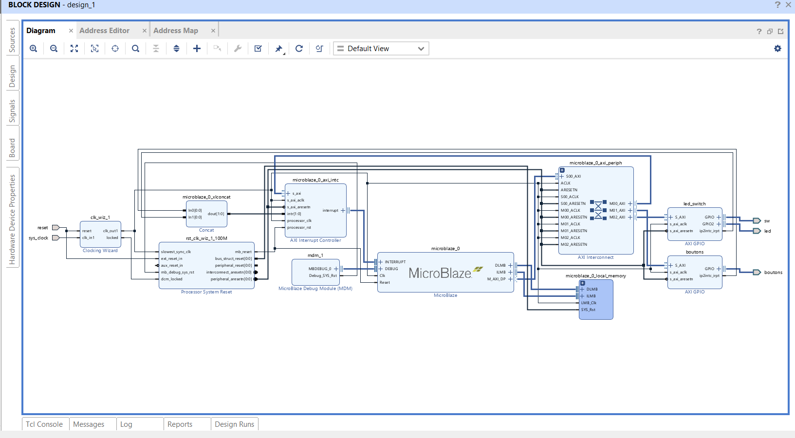
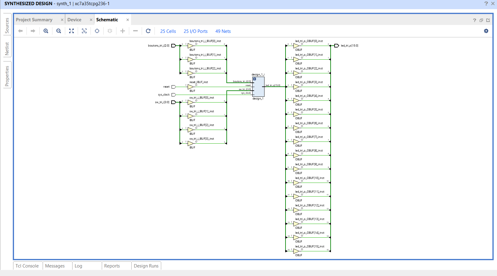

# TP2: MicroBlaze + AXI GPIO, bare-metal C

Basys 3, Master 1 SESI, Sorbonne Université (UE MU4IN108). Back to the [overview](../README.md).

- **Tools:** Vivado 2020.2 IP Integrator, Vitis (BSP, C, debugger), MicroBlaze soft core
- **System:** MicroBlaze (32 KB BRAM, interrupt controller), Clocking Wizard (100 MHz), Processor System Reset, AXI Interconnect, 2 AXI GPIO (switches + LEDs, buttons)
- **Flow:** block design → synthesis → export `.xsa` → Vitis platform and BSP (`xparameters.h`, `XGpio` driver) → C application

## C programs (`src/`)

| File | Behavior |
| --- | --- |
| `exo1_led_switch.c` | Reads the switches, writes them to the LEDs |
| `exo2_blink_counter.c` | Blinking zone + switch zone + 4-bit counter incremented by the center button, with software rising-edge detection (same principle as TP1) |
| `exo3_chenillard.c` | One LED shifted left, delay set by `SW[3:0]` (16 speeds) |

Program run and stepped in the Vitis debugger (breakpoints, variable watch).

