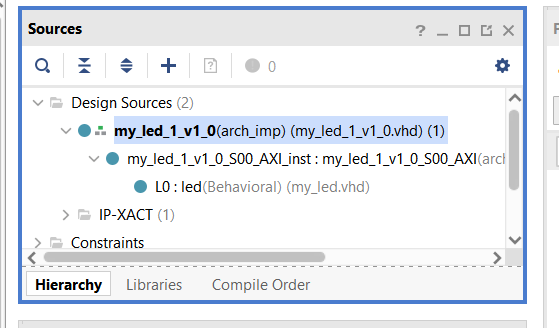
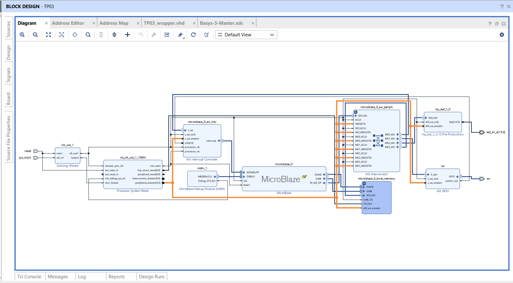
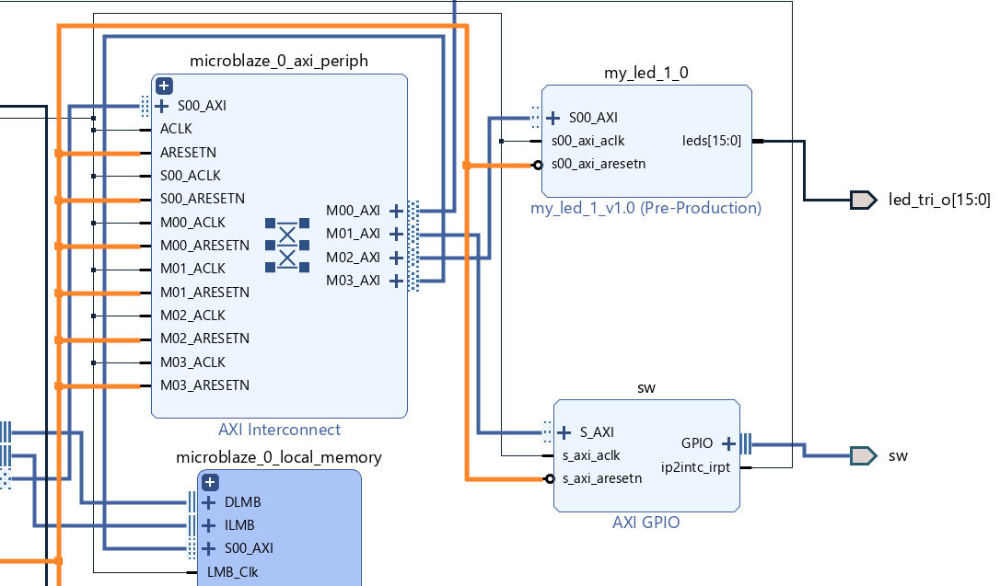

# TP3: custom AXI4-Lite IP `my_led`

Basys 3, Master 1 SESI, Sorbonne Université (UE MU4IN108). Back to the [overview](../README.md).

- **Tools:** VHDL, Vivado 2020.2 IP packager and IP Integrator, Vitis, C
- **Design:** `my_led` replaces the LED GPIO of TP2; the MicroBlaze writes slave registers over AXI4-Lite and the IP drives 16 LEDs
- **Result:** IP packaged, integrated and driven from C through the generated driver macros

## 1. IP structure

| Layer | File | Role |
| --- | --- | --- |
| Top | `my_led_v1_0.vhd` | Exposes `leds[15:0]` and the AXI interface |
| AXI wrapper | `my_led_v1_0_S00_AXI.vhd` (changes in `wrapper_modifications_S00_AXI.vhd`) | Protocol and 4 slave registers `slv_reg0..3` |
| Logic | `my_led.vhd` | Combinatorial: each `sw_state` bit turns on a group of 4 LEDs |

Register mapping: `slv_reg0(0)` → LED 3:0, `slv_reg0(1)` → LED 7:4, `slv_reg1(0)` → LED 11:8, `slv_reg1(1)` → LED 15:12.



## 2. Integration

GPIO `led_switch` removed, GPIO `sw` (4 bits) kept for the switches, `my_led_1_0` added, output `leds[15:0]` connected to `led_tri_o[15:0]`.




## 3. C driver use (`src/main_tp3.c`)

```c
sw_value = XGpio_DiscreteRead(&sw_gpio, 1);
MY_LED_mWriteReg(MY_LED_BASE, MY_LED_S00_AXI_SLV_REG0_OFFSET, sw_value & 0x3);
MY_LED_mWriteReg(MY_LED_BASE, MY_LED_S00_AXI_SLV_REG1_OFFSET, (sw_value >> 2) & 0x3);
```

- The BSP detects the IP and generates its driver
- Vivado 2020.2 generates a faulty driver Makefile for custom IPs; replaced by the corrected course version
